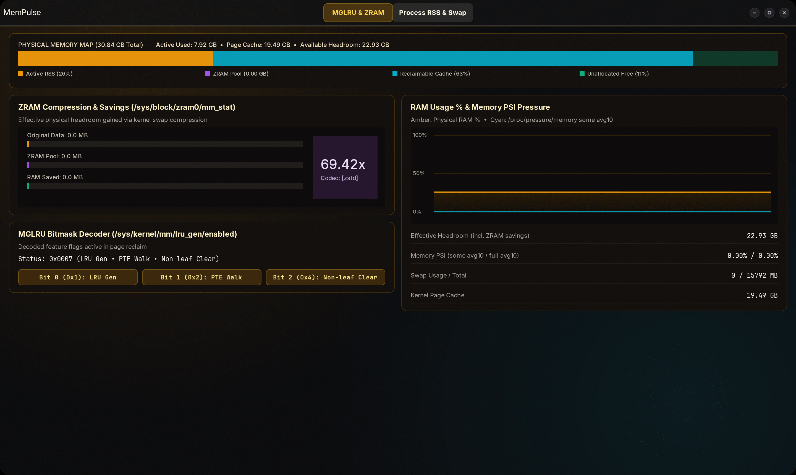

# mempulse

Linux MGLRU, ZRAM, and memory pressure monitor written in C and Python/GTK4.

<p align="center">
  
</p>

## What it reads

- **MGLRU Flags:** Reads and decodes `/sys/kernel/mm/lru_gen/enabled` bitmask flags (`LRU Gen`, `PTE Walk`, `Non-leaf Clear`).
- **ZRAM Compression Stats:** Reads `/sys/block/zram0/mm_stat` to show original vs compressed data sizes and calculate effective physical RAM headroom.
- **Memory PSI & Processes:** Reads `/proc/pressure/memory` (`some`/`full` `avg10`), `/proc/meminfo` (used RAM, buffers/cache), and top processes by RSS + swap usage.

<details>
<summary>Static UI screenshot (overview.png)</summary>


</details>

## Build & Run

```bash
make all
make test
./mempulse-probe --json
PYTHONPATH=src /usr/bin/python3 -m mempulse.gui
```

## Related

[ff-power-manager](https://github.com/lwrlock/ff-power-manager) · [ebpf-latency-guard](https://github.com/lwrlock/ebpf-latency-guard) · [vram-atlas](https://github.com/lwrlock/vram-atlas) · [waylens-privacy](https://github.com/lwrlock/waylens-privacy) · [netpulse-bpf](https://github.com/lwrlock/netpulse-bpf) · [nvme-sentinel](https://github.com/lwrlock/nvme-sentinel)

## License & Development

MIT — see [LICENSE](LICENSE). Built by Furkan (`@lwrlock`) with AI coding assistance (Google DeepMind Antigravity) and verified on bare-metal Linux hardware.
