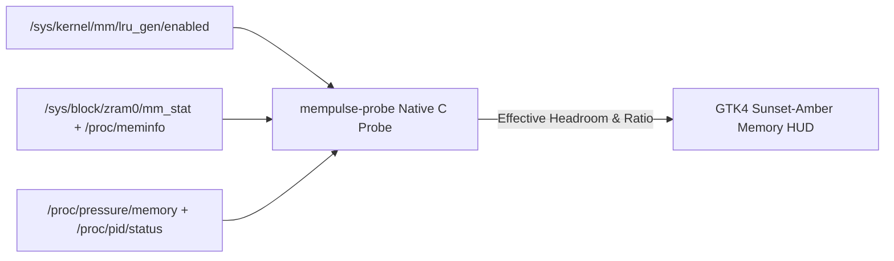
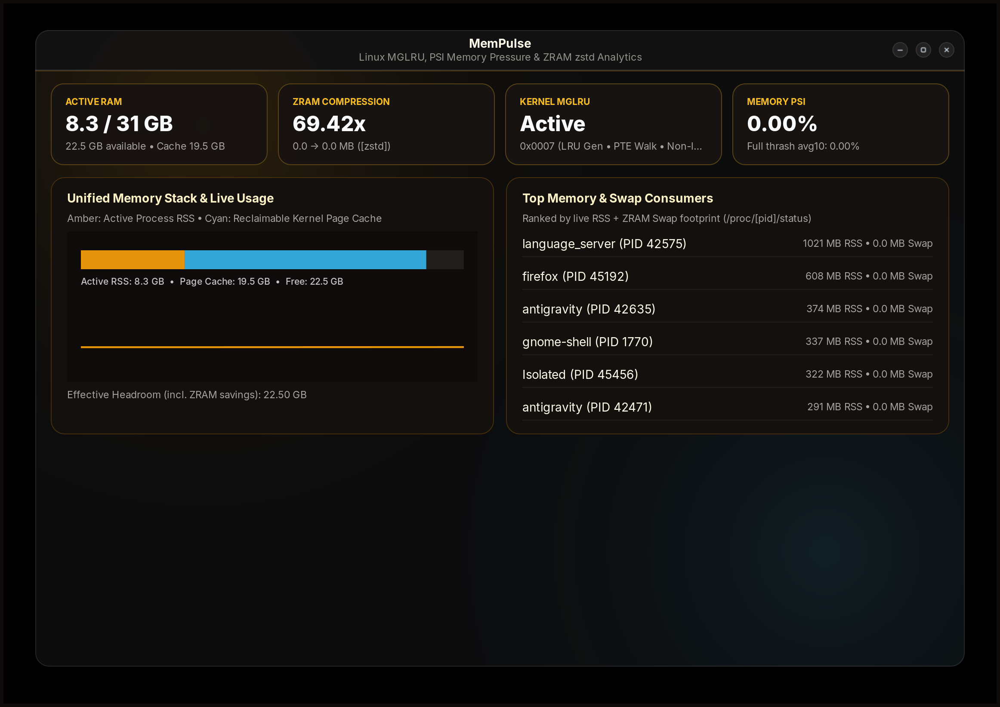

# MemPulse

[](LICENSE)
[](#architecture)
[](#gallery)
[](https://github.com/lwrlock/ff-power-manager)

**Real-time Linux MGLRU (`lru_gen`), Memory PSI (`/proc/pressure/memory`), and `zstd` ZRAM Compression Analytics Suite built in C and Python/GTK4.**

<p align="center">
  
</p>

## Architecture



## Highlights

- **MGLRU Bitmask Telemetry:** Decodes `/sys/kernel/mm/lru_gen/enabled` (`0x0007` → LRU Gen • PTE Walk • Non-leaf Clear).
- **Live ZRAM Compression Ratio:** Reads `/sys/block/zram0/mm_stat` to compute effective physical RAM headroom gained via `zstd`.
- **Memory Thrash Early Warning (`PSI`):** Tracks `some` and `full` `avg10` memory pressure alongside stacked RSS + Page Cache charts and top RSS/Swap consumers.

<details>
<summary><b>Full-Resolution UI Screenshot</b></summary>

<p align="center">
  
</p>

</details>

## Build & Run

```bash
make test
./mempulse-probe --json
PYTHONPATH=src /usr/bin/python3 -m mempulse.gui
```

---

### FF Linux Kernel & Systems Suite
[FF Power Manager](https://github.com/lwrlock/ff-power-manager) · [eBPF Latency Guard](https://github.com/lwrlock/ebpf-latency-guard) · [VRAM Atlas](https://github.com/lwrlock/vram-atlas) · [Waylens Privacy](https://github.com/lwrlock/waylens-privacy) · **MemPulse** · [NetPulse BPF](https://github.com/lwrlock/netpulse-bpf) · [NVMe Sentinel](https://github.com/lwrlock/nvme-sentinel)

MIT License — Copyright (c) 2026 Furkan (**lwrlock**). Built with assistance from Google DeepMind Antigravity.
